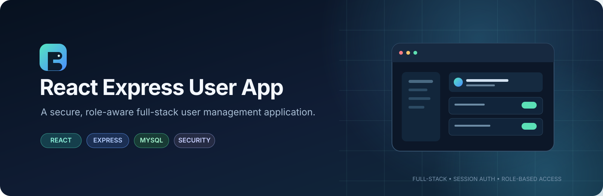
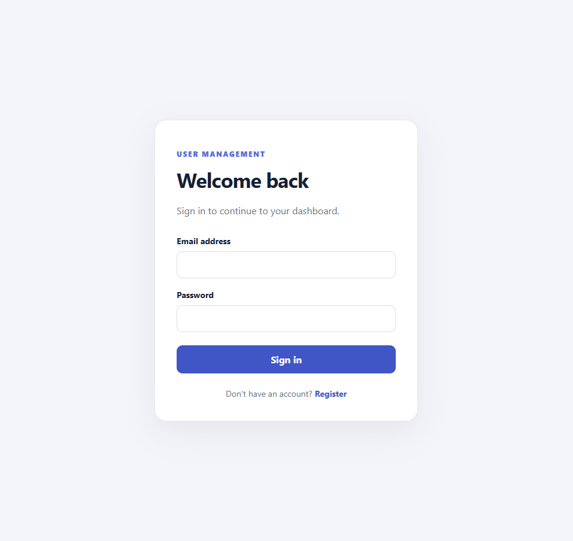
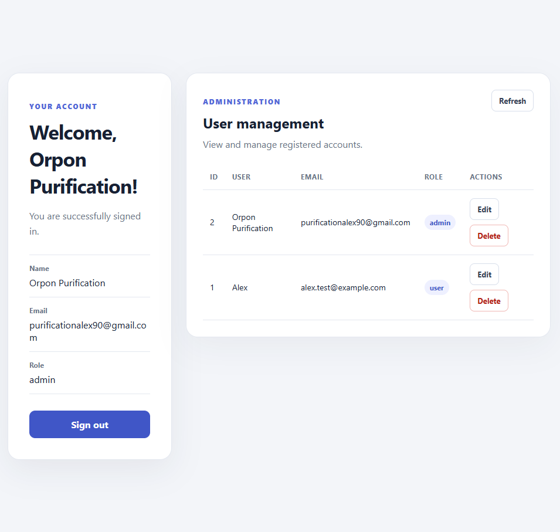

<!-- Premium project banner -->
<p align="center">
  
</p>

<h1 align="center">React Express User App</h1>

<p align="center">
  A full-stack user management application built with React, Express, and MySQL.
  <br />
  Secure sessions · Role-based authorization · CSRF protection · Admin user management
</p>

<p align="center">
  <a href="https://github.com/OrpanAp/react-express-user-app"></a>
  
  
  
</p>

## Contents

- [Overview](#overview)
- [Application screenshots](#application-screenshots)
- [Features](#features)
- [Tech stack](#tech-stack)
- [Architecture](#architecture)
- [Getting started](#getting-started)
- [API overview](#api-overview)
- [Security notes](#security-notes)
- [Development scripts](#development-scripts)
- [Roadmap](#roadmap)
- [Author](#author)


---

## Overview

**React Express User App** is a full-stack web application for account registration, login, session persistence, and administrator-only user management. It pairs a Vite-powered React interface with an Express API and a MySQL database.

The project focuses on practical backend fundamentals: password hashing, server-side sessions stored in MySQL, protected API routes, role checks against current database records, CSRF token validation, and parameterized database queries.

> **Project status:** Portfolio and learning project. The application demonstrates practical full-stack development and security patterns; it has not undergone an independent production security audit.

## Application screenshots

The following screenshots show the application's actual interface.

<table>
  <tr>
    <td width="50%" align="center" valign="top">
      
      <br /><strong>Authentication</strong>
      <br /><sub>Registration and sign-in interface</sub>
    </td>
    <td width="50%" align="center" valign="top">
      
      <br /><strong>Admin dashboard</strong>
      <br /><sub>Dashboard and user-management interface</sub>
    </td>
  </tr>
</table>

<p align="center"><sub>Interface previews from the project. Demonstration environments should use non-sensitive test data.</sub></p>

## Features

- **Account registration and login** with server-side input validation.
- **Password hashing** using bcryptjs; plaintext passwords are not stored.
- **Persistent login sessions** stored in MySQL through `express-session` and `express-mysql-session`.
- **CSRF protection** for state-changing requests using a session-bound token and the `X-CSRF-Token` header.
- **Role-based authorization** for administrator-only user-management endpoints.
- **User administration** to list, update, and delete eligible user accounts.
- **Last-administrator and self-deletion safeguards** in the user deletion flow.
- **Parameterized SQL queries** to reduce SQL-injection risk.
- **Login and registration rate limiting** to help limit repeated authentication attempts.
- **Credential-aware CORS** for the React development origin.
- **Responsive React UI** for authentication, dashboard, and user-table workflows.
- **Health and database checks** through dedicated API endpoints.

## Tech stack

| Layer | Technologies |
|---|---|
| Frontend | React 19, Vite 8, JavaScript, CSS |
| Backend | Node.js, Express 5 |
| Database | MySQL, `mysql2/promise` |
| Authentication | `bcryptjs`, `express-session` |
| Session storage | `express-mysql-session` |
| Security middleware | `cors`, `express-rate-limit`, custom CSRF middleware |
| Development | npm, Nodemon, ESLint, Git |

## Architecture

```text
react-express-user-app/
├── client/
│   └── src/
│       ├── components/
│       │   ├── AuthForm.jsx
│       │   ├── Dashboard.jsx
│       │   └── UsersTable.jsx
│       ├── services/
│       │   └── api.js
│       ├── App.jsx
│       ├── App.css
│       ├── index.css
│       └── main.jsx
├── server/
│   ├── src/
│   │   ├── config/
│   │   │   ├── db.js
│   │   │   └── session.js
│   │   ├── controllers/
│   │   │   ├── authController.js
│   │   │   └── userController.js
│   │   ├── middleware/
│   │   │   ├── csrfProtection.js
│   │   │   ├── requireAdmin.js
│   │   │   └── requireAuth.js
│   │   ├── routes/
│   │   │   ├── authRoutes.js
│   │   │   └── userRoutes.js
│   │   └── server.js
│   └── .env                 # Create locally; never commit
├── docs/
│   ├── assets/              # README banner assets
│   └── screenshots/         # Actual authentication and admin screenshots
└── .gitignore
```

## Getting started

### Prerequisites

- Node.js and npm
- MySQL Server (or a compatible local MySQL setup)
- Git

### 1. Clone the repository

```bash
git clone https://github.com/OrpanAp/react-express-user-app.git
cd react-express-user-app
```

### 2. Create the database and users table

Run the following SQL in MySQL or a tool such as phpMyAdmin:

```sql
CREATE DATABASE IF NOT EXISTS react_express_user_app;
USE react_express_user_app;

CREATE TABLE IF NOT EXISTS users (
    id INT UNSIGNED AUTO_INCREMENT PRIMARY KEY,
    user_name VARCHAR(100) NOT NULL,
    email VARCHAR(255) NOT NULL UNIQUE,
    password_hash VARCHAR(255) NOT NULL,
    role ENUM('user', 'admin') NOT NULL DEFAULT 'user',
    created_at TIMESTAMP NOT NULL DEFAULT CURRENT_TIMESTAMP,
    updated_at TIMESTAMP NOT NULL DEFAULT CURRENT_TIMESTAMP
        ON UPDATE CURRENT_TIMESTAMP
);
```

The session store is configured to create its own session table. Make sure the configured MySQL account has permission to create and manage that table.

### 3. Configure the environment

#### Forntend: Create `client/.env` locally. Do not commit this file.

```dotenv
VITE_API_URL=http://localhost:3000/api
```

#### Backend: Create `server/.env` locally. Do not commit this file.

```dotenv
PORT=3000
CLIENT_URL=http://localhost:5173

DB_HOST=localhost
DB_PORT=3306
DB_USER=your_mysql_username
DB_PASSWORD=your_mysql_password
DB_NAME=react_express_user_app

SESSION_SECRET=replace_with_a_long_random_secret
MODE=development
```

Generate a strong session secret locally, for example:

```bash
node -e "console.log(require('crypto').randomBytes(32).toString('hex'))"
```

Store the generated value only in your local environment configuration and keep it private. Use a different secret for each environment.

### 4. Install dependencies

Open a terminal in the project root and install the backend dependencies:

```bash
cd server
npm install
```

Open a **second terminal** in the project root and install the frontend dependencies:

```bash
cd client
npm install
```

### 5. Start the backend

In the backend terminal:

```bash
cd server
npm run dev
```

The API should start at `http://localhost:3000`.

### 6. Start the frontend

In the frontend terminal:

```bash
cd client
npm run dev
```

Open the local URL printed by Vite, normally **http://localhost:5173**.

### 7. Verify the API

Open these endpoints in your browser:

- `http://localhost:3000/api/health` — checks whether the API is running.
- `http://localhost:3000/api/db-test` — checks whether the server can query MySQL.

Do not expose the database test endpoint publicly without reviewing whether it is appropriate for your deployment.

## API overview

All endpoints are served by the Express backend at `http://localhost:3000`.

| Method | Endpoint | Purpose | Access |
|---|---|---|---|
| `GET` | `/api/health` | API health check | Public |
| `GET` | `/api/db-test` | Test database connectivity | Local development |
| `GET` | `/api/auth/csrf-token` | Issue a CSRF token for the current session | Session |
| `POST` | `/api/auth/register` | Register an account | Public, rate-limited |
| `POST` | `/api/auth/login` | Sign in and create a session | Public, rate-limited |
| `GET` | `/api/auth/me` | Get the current session user | Signed-in session |
| `POST` | `/api/auth/logout` | End the current session | Session |
| `GET` | `/api/users` | List users | Administrator |
| `PUT` | `/api/users/:id` | Update an eligible user record | Administrator |
| `DELETE` | `/api/users/:id` | Delete an eligible account | Administrator |

Mutating requests require the CSRF token expected by the server. The frontend API service handles token retrieval and sends it in the `X-CSRF-Token` header.

## Security notes

- Never commit `server/.env`, passwords, session secrets, exported cookies, or real user data.
- Session cookies are configured as HTTP-only and use `SameSite=Lax`; the `Secure` flag is enabled when `MODE=production`. Production deployments must use HTTPS and be configured correctly for their proxy/hosting environment.
- Keep React and API origins aligned with `CLIENT_URL`; credentialed CORS should use an explicit trusted origin rather than a wildcard.
- Create an administrator account through a controlled, local process. New registrations default to the `user` role; do not allow public registration to choose its own role.
- Review and test authorization, CSRF behavior, session expiration, and account deletion safeguards before deploying to a public environment.
- The included safeguards are not a substitute for a security audit or production hardening.

## Development scripts

### Backend (`server/`)

| Command | Description |
|---|---|
| `npm run dev` | Start Express with Nodemon |
| `npm start` | Start Express normally |

### Frontend (`client/`)

| Command | Description |
|---|---|
| `npm run dev` | Start the Vite development server |
| `npm run build` | Build the frontend for production |
| `npm run preview` | Preview the production build locally |
| `npm run lint` | Run ESLint |

## Roadmap

- [ ] Add a personal profile page and profile-update API for regular users.
- [ ] Add automated backend tests for authentication, authorization, CSRF, and user-management edge cases.
- [x] Capture real application screenshots and include them in the README.
- [ ] Document the controlled administrator-creation workflow.
- [ ] Add deployment instructions after choosing a hosting environment.

## Author

**Alex Purification**  
Full-Stack Web Developer

- GitHub: [@OrpanAp](https://github.com/OrpanAp)
- Project repository: [react-express-user-app](https://github.com/OrpanAp/react-express-user-app)

---

<p align="center">
  Built to practice secure full-stack development with React, Express, and MySQL.
</p>
